#652 は main に squash 済み。この PR だけの差分は main（4d8ca74）との差分そのもの（head 788a2f9。main は 137b085・52f6a8e・788a2f9 で取り込み、どれも衝突なし）。

## Issue リンク / Link to Issue

Closes #635（親: #627）。

### 概要

閲覧コードを間違え続けて締め出された時の表示を変えました。待つ必要があることと残りの目安を出します。その間は入力欄とボタンを押せません。入力は消えません。コードが違う時と通信できない時の文言も、デザイン板 G のものに分けています。

### 見て欲しいポイント

- [ ] 残りの目安を応答の retry-after ヘッダから出している点（ヘッダが無い時は締め出しの長さ 15 分で代用）
- [ ] 締め出しが明けた時に知らせを消して入力できる状態に戻す点
- [ ] 入力欄の赤枠はコードが違う時だけ（通信失敗・締め出しでは通常の枠線 #71858c のまま）
- [ ] 締め出し中は入力欄を薄くしない（`disabled:opacity-100`。ボード G の `.inp` に透過の指定が無いため。準備前（#398）は今までどおり薄い）

### 見なくてもよいポイント

- [ ] e2e の文言を新しいものに直した 2 行（e2e/adversarial.spec.ts）
- [ ] main（#652 の squash）の取り込みの衝突解消（下記）

### その他(あれば)

- 2026-11-14 は Vercel の無料プランの 1 日の配信回数を使い切っていて、この head の「Vercel」の状態が failure になることがある（Deployment rate limited — retry in 24 hours）。コードの失敗ではない。検査は持ち主の裁定どおり手元の検査（LOCAL-CHECK のコメント）で見る。

実装の差分は app/viewer-auth/page.tsx の状態の出し分けと src/util/read-retry-after.ts です。ほかは e2e の文言修正、テストの追加、証拠画像です。

**main 取り込みの衝突解消（0abcce9）**: #652 が squash されたため 3 ファイルが衝突しました。
- app/viewer-auth/page.tsx: 衝突箇所は全部この PR 側を採用（main 側の `error` 文字列 state と旧文言は消え、状態の出し分けに置き換わっている。準備前のボタン名「準備しています…」は両方同じ）
- app/viewer-auth/page.test.tsx（add/add）: この PR 側を採用（main 側の準備前・準備後などの既存 3 テストはこの PR 側にも入っている）
- e2e/viewer-auth-ready-gate.spec.ts: main（#652）の版そのまま
- その後 main を取り込み済み: 8242d36（137b085）・94fe259（52f6a8e）・4d8ca74（788a2f9）。どれも衝突なし

画像1: 締め出し中（変更前 main / 変更後 32e9c9c。使い捨て DB で間違いのコードを続けて送って起こした。サーバーは 9 回目の送信で締め出しを返す）

| | 変更前 | 変更後 |
|---|---|---|
| 明・1440 | 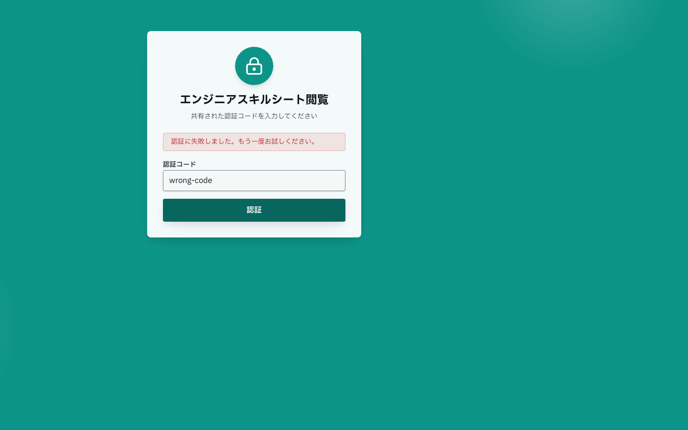 | 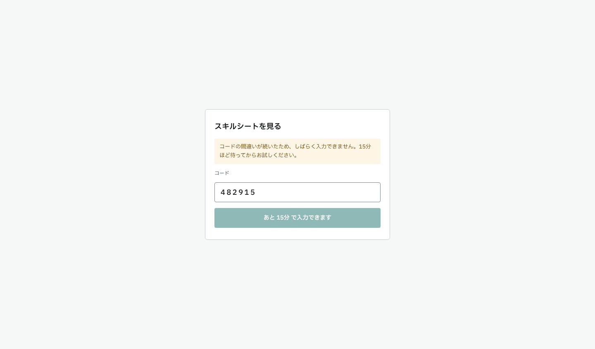 |
| 明・390 | 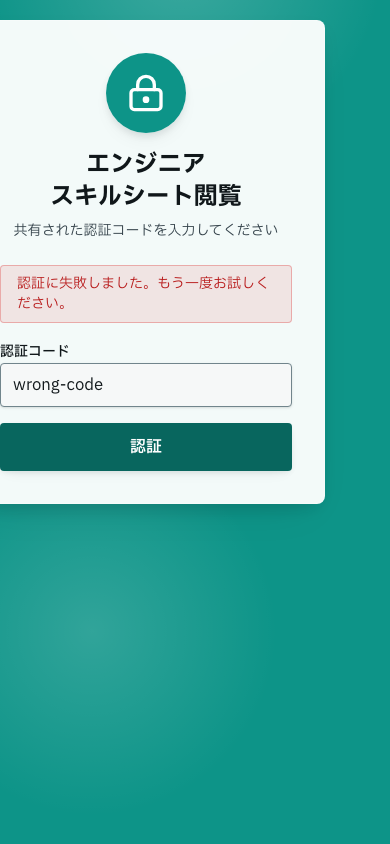 | 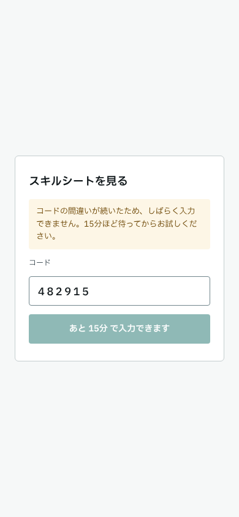 |
| 暗・1440 |  | 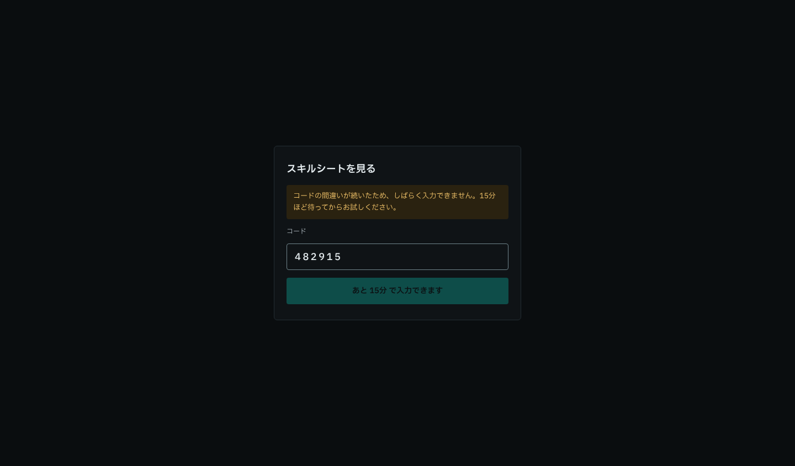 |
| 暗・390 | 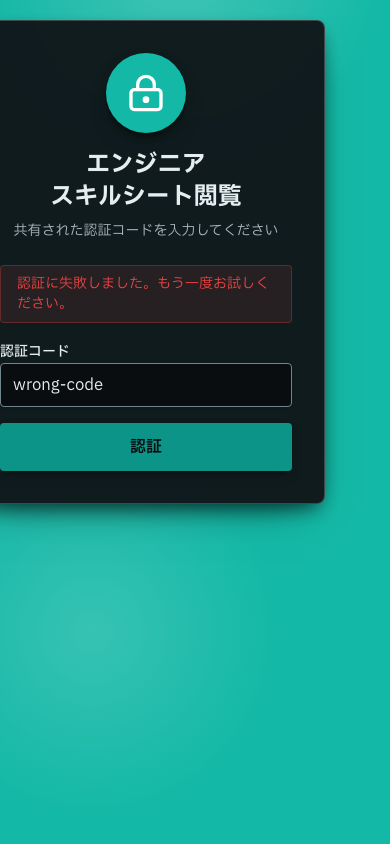 | 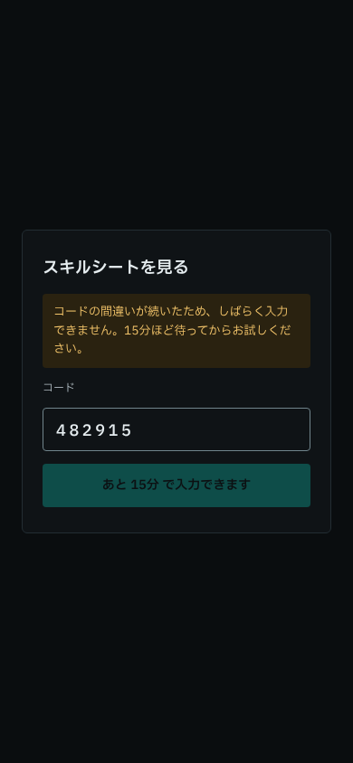 |

変更前は「認証に失敗しました。もう一度お試しください。」と出るだけで、ボタンも押せました。

変更後の 4 枚は 32e9c9c で撮り直しました（入力欄の不透明度が 1 であることを実測）。

画像2: コードが違う時

| | 変更前 | 変更後 |
|---|---|---|
| 明・1440 | 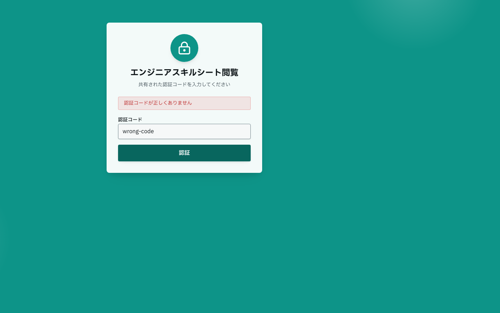 | 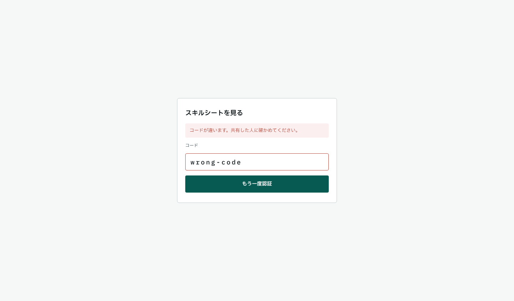 |
| 明・390 | 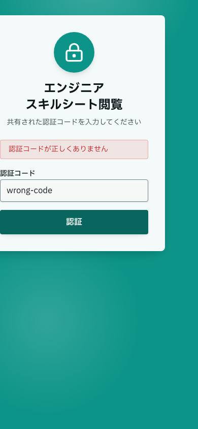 | 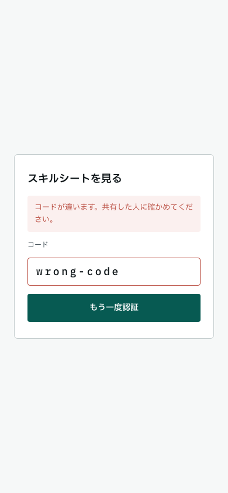 |
| 暗・1440 | 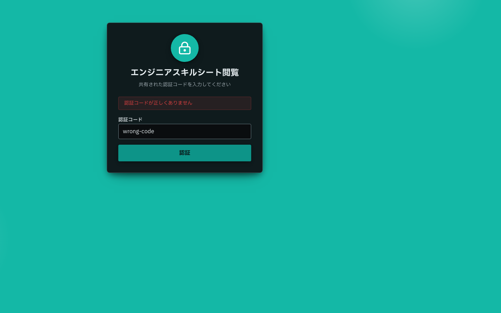 | 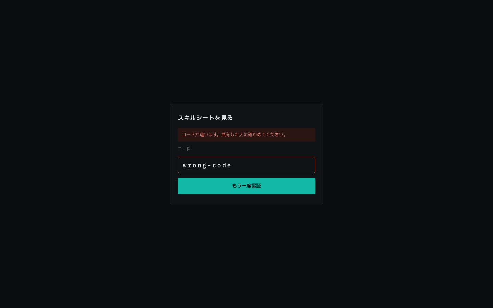 |
| 暗・390 | 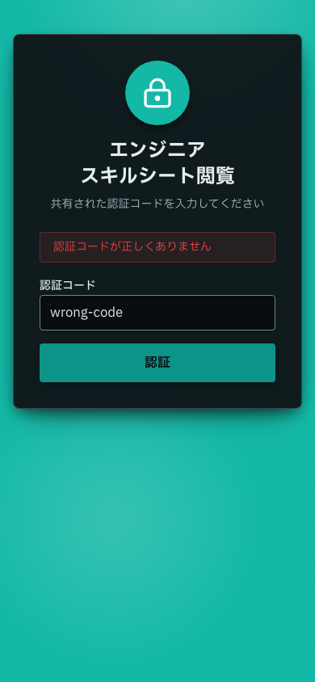 | 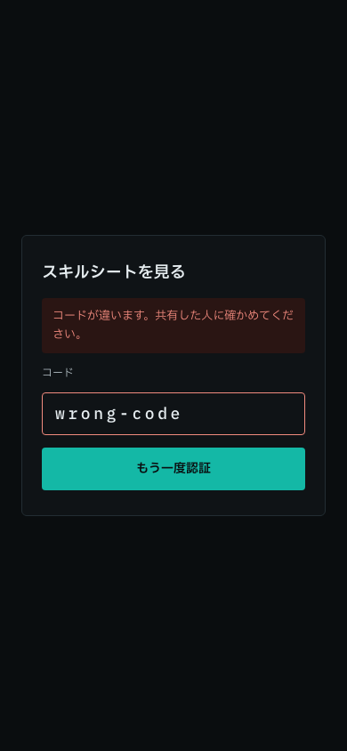 |

画像3: 通信できない時（変更後。撮影は b32e00e。認証の送信だけを Playwright の page.route で中断して撮りました）

| | 変更後 |
|---|---|
| 明・1440 | 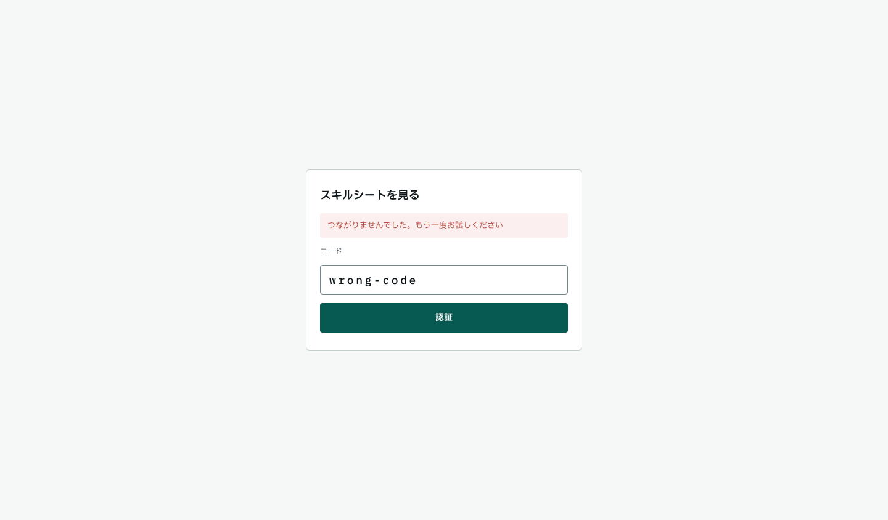 |
| 明・390 | 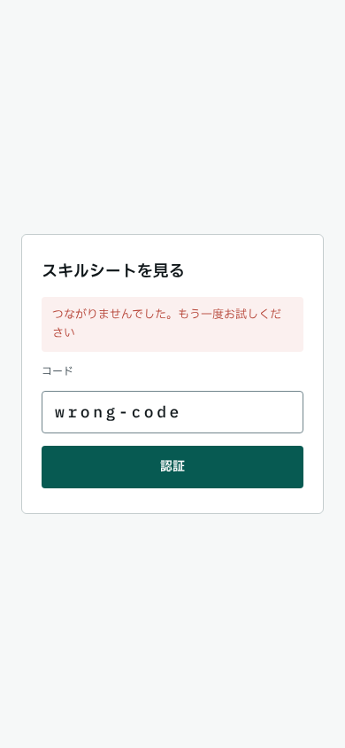 |
| 暗・1440 | 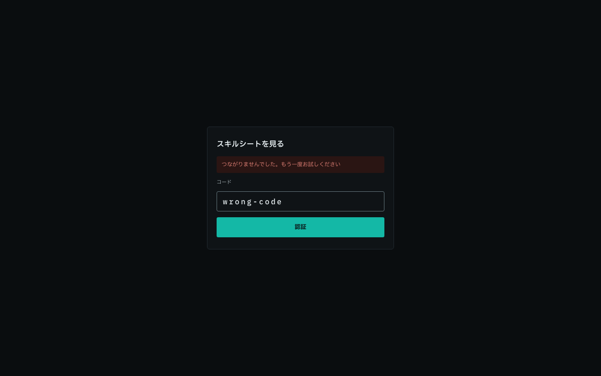 |
| 暗・390 | 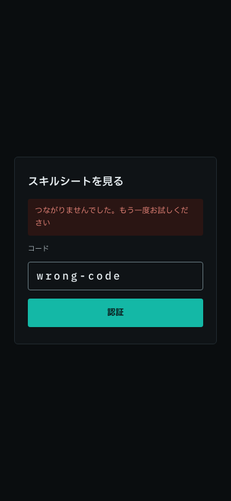 |

サーバーには届かないため失敗の回数は増えません。変更前（main）は通信が失敗してもコードが違う時と同じ文言が出るだけなので、変更前の画像は撮っていません。

板 G（#627 のコメントの値）と実装の見比べ（コードと画像の読み比べ。板の描画との画素重ね合わせはしていない）

| 項目 | 板 G | 実装 | 判定 |
|---|---|---|---|
| 3a 文言 | 「コードが違います。共有した人に確かめてください。」 | 同じ | 一致 |
| 3a 知らせの色 | 明 #fbf0ef / #b64437、暗 #2a1513 / #f28b7f | 同じ値 | 一致 |
| 3a 入力 | 値は残す・枠線を赤 | 値は残る。枠線は実測で明 rgb(182,68,55)=#b64437、暗 rgb(242,139,127)=#f28b7f | 一致 |
| 3a ボタン | 「もう一度認証」 | 同じ | 一致 |
| 3b 文言 | 「つながりませんでした。もう一度お試しください」 | 同じ | 一致 |
| 3b 入力 | 値は残す（赤枠の指定なし） | 値は残る。枠線は通常の #71858c（赤にしない） | 一致 |
| 4 文言 | 「コードの間違いが続いたため、しばらく入力できません。15分ほど待ってからお試しください。」（role="alert"） | 同じ | 一致 |
| 4 知らせの色 | 明 #fdf6e6 / #6b4400、暗 #2a2210 / #f5c66b | 同じ値 | 一致 |
| 4 入力 | 値を残したまま disabled・薄くしない（板の .inp は disabled でも不透明度の指定なし） | 値は残り disabled。不透明度は実測 1（明暗・1440/390 の 4 枚。変更前は共有 Input の disabled:opacity-50 で 0.5 だった）。字色は明 rgb(16,23,26)・暗 rgb(230,237,240) のまま。横あふれなし（scrollWidth = clientWidth） | 一致（32e9c9c で修正） |
| 4 ボタン | 「あと 14分 で入力できます」・押せない・不透明度 0.45 | 「あと N分 で入力できます」（N は retry-after から。撮った画像は 15）・disabled・不透明度 0.45 | 一致（14 は板の見本の数字） |
| 知らせの寸法 | 角丸 4px・余白 上下 10px 左右 12px・13px・行間 1.6 | 同じ指定 | 一致 |
| 欄とボタンの高さ | 48px | 実測 48px（12 枚全部） | 一致 |
| 通常の枠線 | 1px #71858c | 実測 1px rgb(113,133,140)=#71858c（3b・4 の画像で計測） | 一致 |

暗テーマの押せないボタンは文字が読みにくいですが、板の不透明度 0.45 のとおりです。

確認

- 画像: 締め出し中の 4 枚は 32e9c9c で撮り直しました（入力欄の opacity は 4 枚とも 1）。コード違い・通信失敗の 8 枚は b32e00e で撮った物のままです。どれも枠線の transition が終わるまで 800ms 待ってから撮影・計測、deviceScaleFactor 1、overlay 要素 0 件、横はみ出し無し（390 で scrollWidth = clientWidth = 390）。名前は `./script/check-naming.sh` を通っています（終了コード 0）
- lint・type-check・build は 32e9c9c で実行し、終了コード 0。test は 32e9c9c で jsdom 1123 件・node 1201 件（1 スキップ）・node（PDF）229 件（7 スキップ）が通過、失敗 0。ただし `pnpm test` は 1 回で通し切れず（1 回目は負荷による vitest worker の時間切れ、2 回目は `script/verify-607-lifecycle.test.ts` の時間に依存する 1 件。単独では 24/24 通過）、node と PDF の設定は分けて回し直しました。788a2f9 との差は main の取り込みだけです（この PR のファイルとは重なりません）
- e2e: 0abcce9 の時点で、使い捨て DB を使う CI と同じ手順を手元で回し、Playwright 100 件通過・失敗 0、headless 2 シナリオ成功でした。32e9c9c では回していません。CI に任せます
- 追加したテスト: app/viewer-auth/page.test.tsx（コードが違う・通信できない・締め出し中の 3 状態、締め出し中の送信拒否と明けた後の復帰、retry-after が無い時）と src/util/read-retry-after.test.ts
- 実行環境: ローカル（Linux）。GitHub Actions の結果は CI を見てください

---

### PR チェックポイント

- [x] タイトルに タスク管理ツール のチケット番号が入っているか（細かい hotfix 以外）
- [x] 複数の変更が 1 つの PR に入り込んでいないか（締め出し中の表示と文言だけ。見た目は #634）
- [x] 開発環境修正(環境変数の追加・ライブラリのインストール等)がある場合は周知しているか（該当なし）
- [x] AdminXXX or OwnerXXX の修正時、横展開でもう一方の同機能も修正しているか（該当なし）

### レビュー観点

- [ ] 想定通りに動作するか
- [ ] より良い書き方はないか？
- [ ] より良い設計はないか？
- [ ] 他の部分と書き方・命名・ディレクトリ構成等が異なっていないか？
- [ ] 関数・コンポーネントの粒度は適切か？
- [ ] その他(具体的に記述をしてください)

https://claude.ai/code/session_01Cv4a6DwUJfq3id6nSYbwGr

---
_Generated by [Claude Code](https://claude.ai/code)_
