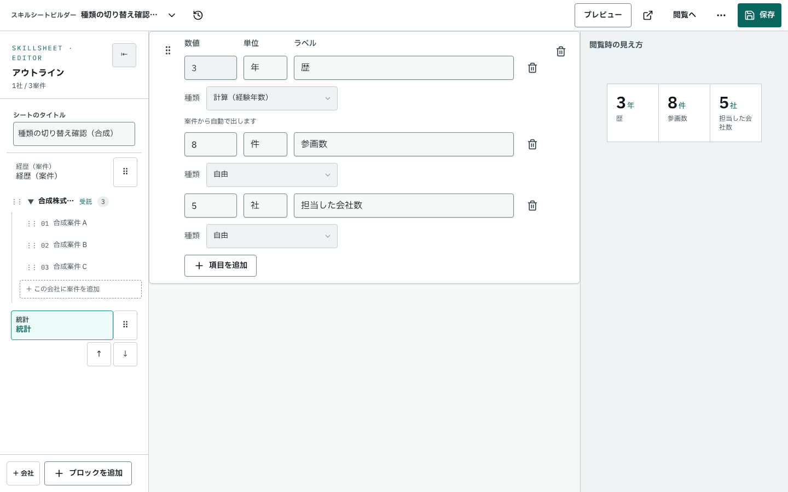
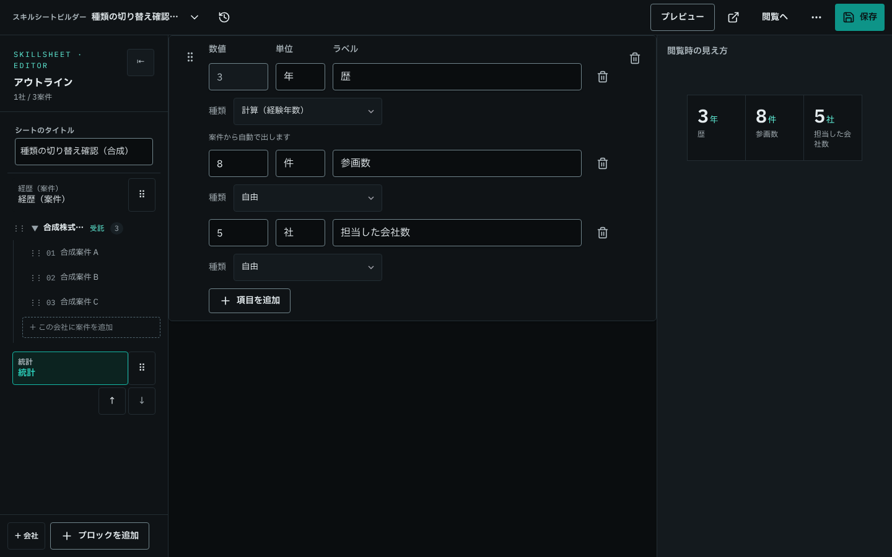
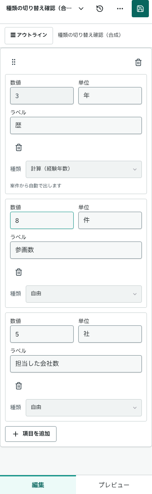
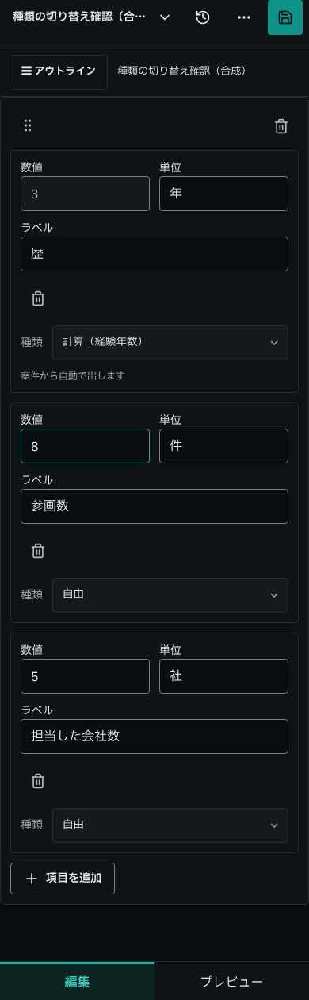
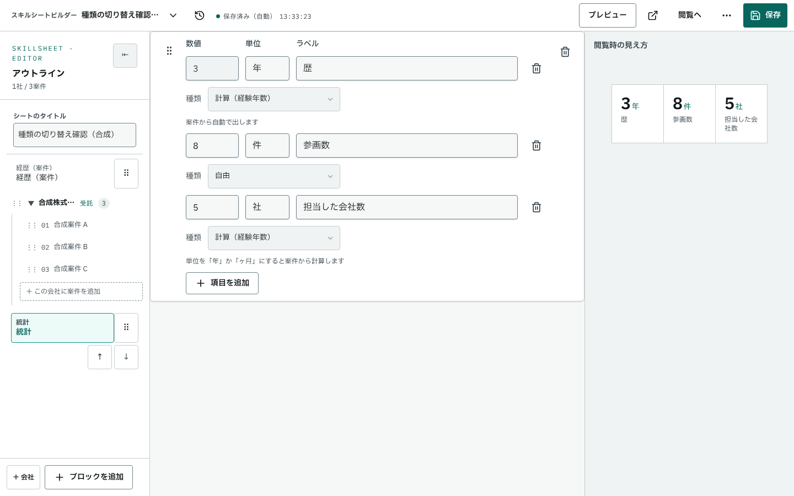
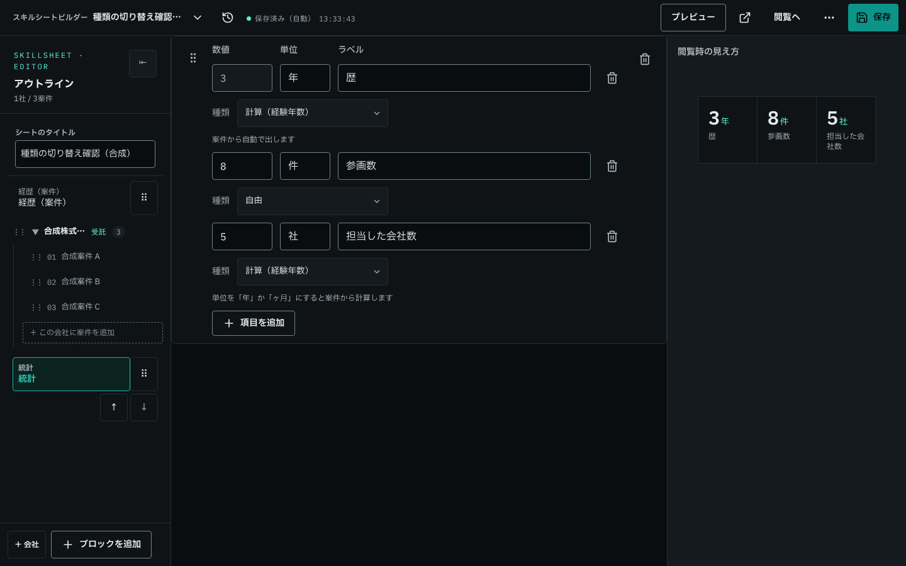
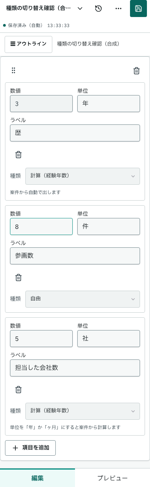
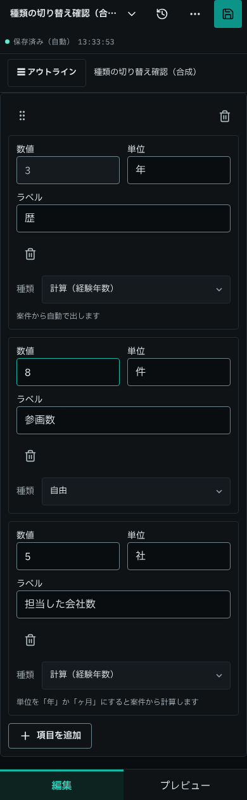

## Issue リンク / Link to Issue

Closes #666（親 #628）

### 概要

数字カードの編集欄に、項目ごとの「種類」の選択欄を足しました。これまでは最初の保存時にラベルから決まった種類を、画面から変えられませんでした。

- 選択肢は保存の形の `kind` の 3 値そのまま（`experience` = 計算（経験年数）/ `projectCount` = 計算（案件数）/ `free` = 自由）。値の集合は変えていません。DB の移行も、保存の形の変更もありません。
- 変更したファイルは、実装 `app/builder/block-editor/stat-block-editor.tsx`、試験 `app/builder/block-editor/stat-block-editor.test.tsx`、画像 8 枚（`doc/stat-kind-evidence/`）です。選ぶと `kind` がその項目に入り、従来どおり保存されます。
- 表示は #664 と同じ `isStatComputed` / `resolveDisplayedStats` が `kind` を見て決めるので、閲覧画面・ビルダー・PDF は種類のとおり（計算 → 導出値、自由 → 保存値）になります。計算に切り替えても保存値は書き換えず、自由に戻せば保存値が出ます。
- 案件ブロックが無いシートは、#664 のとおり種類に関わらず編集できます（種類の選択欄は出ます）。
- 「計算」には計算元が 2 つ（経験年数・案件数）あるので、「計算」を 1 つにまとめず、種類をそのまま 2 つ並べました（どちらの値に寄せるかを画面が推測しないため）。
- 「計算（経験年数）」を選んでも単位が「年」「ヶ月」でない項目は、#664 の規則（`isStatComputed`）どおり計算されません。これを画面で分かるようにするため、その項目の下に「単位を「年」か「ヶ月」にすると案件から計算します」の 1 行を出し、種類の選択欄に `aria-describedby` でつないでいます。保存の形も #664 の規則も変えていません（`src/db/derived-display.ts` は未変更）。
- 見た目は、ボードの案件エディタが使う選択欄 `.sel`（既存の `app/builder/editor.css`、案件フォームの「役割」「会社の種別」と同じ）に合わせました。数字カードの N-03 のボードには種類の選択欄が無いため、ボードに無い要素です。

### 見て欲しいポイント

- [ ] 選択肢の出し方（「計算」を 2 つに分けた点）でよいか
- [ ] 計算されない時の 1 行の文言と置き場所（項目の下、「案件から自動で出します」と同じ場所）でよいか
- [ ] 選択欄の置き場所（各項目の下の行）が、390px でも崩れていないか

### 見なくてもよいポイント

- [ ] 画像 8 枚（`doc/stat-kind-evidence/`）

### その他(あれば)

- 2026-11-14 は Vercel の無料プランの 1 日の配信回数を使い切っていて、この head の「Vercel」の状態が failure になることがある（Deployment rate limited — retry in 24 hours）。コードの失敗ではない。検査は持ち主の裁定どおり手元の検査（LOCAL-CHECK のコメント）で見る。

- base は main です（#664 は main に入っています）。差分は #666 の分だけです。
- 種類が未設定の新しい項目は、ラベルを打つと選択欄の表示が変わります（例: 「案件数」と打つと「自由」から「計算（案件数）」へ）。保存時の `fillStatKinds` も同じ推定をするので表示と保存はずれません。これは #661 の設計どおりで、この PR では変えていません。
- 試験: `stat-block-editor.test.tsx` に 9 件足しました（種類の選択欄が出て今の種類が選ばれる／計算 → 自由／自由 → 計算／案件ブロックが無いシート、に加えて、計算されない理由の 1 行が 経験年数 + 社 では出る・経験年数 + 年 / 自由 / 案件ブロック無しでは出ない、の 5 件）。1 行の試験のうち出る側の 2 件は、実装の前に落ちることを確かめています（出ない側は元から通るのが正しい）。保存の形（`itemToBlockInput`）と閲覧側の `resolveDisplayedStats` の値も試験で確かめています。
- 画面: 使い捨てのローカル DB に架空の案件 3 つと数字カードを作り、2 番目の項目を「自由」に切り替えて 8 を入れ、自動保存後に読み直した画面です（1 番目は計算で読み取り専用、2・3 番目は自由で編集可）。明・暗 × 1440・390 で横のはみ出しはありません（production build、390px は全項目と 1 行が見える高さで撮影）。計算されない状態（項目 3 を「計算（経験年数）」、単位は社）も明・暗 × 1440・390 で撮りました。
- 手元の検査: head bc7ac38 で `pnpm lint` / `pnpm type-check` / `pnpm test`（2560 件通過・失敗 0・skip 9）/ `pnpm build` / `./script/check-naming.sh` がすべて 0。詳しくは LOCAL-CHECK のコメントを参照。`pnpm test` は負荷の高い環境で `builder-client.test.tsx` が 1〜2 件、時間切れで落ちる（#661 の本文にある既知の件。単独では 57 件全部通る）。

計算されない状態（経験年数 + 社）:

---
### PR チェックポイント
- [x] タイトルに タスク管理ツール のチケット番号が入っているか（細かい hotfix 以外）
- [x] 複数の変更が 1 つの PR に入り込んでいないか
- [x] 開発環境修正(環境変数の追加・ライブラリのインストール等)がある場合は周知しているか（該当なし）
- [x] AdminXXX or OwnerXXX の修正時、横展開でもう一方の同機能も修正しているか（該当なし）

🤖 Generated with [Claude Code](https://claude.com/claude-code)

https://claude.ai/code/session_01Cv4a6GH8YuxUe328FttVhH
