## Issue リンク / Link to Issue

Closes #671

### 概要

デザインボードとの差のうち、テーマ全体に効く色 4 つを `app/globals.css` のトークンで直した。画面ごとの個別指定は無い。

- 暗い配色の主ボタン: 地 #0d9488 → #14b8a6、文字 #0a0d0f → #03110f、hover #14b8a6 → #2dd4bf（ボード値。hover は地が #14b8a6 になったので #2dd4bf へ）
- 危険の色（`--destructive`）: 明 #dc2626 → #b64437、暗 #ef4444 → #e9695c。hover は同系色で作り直し（明 #9f3a2f、暗 #f08a80）
- 暗い配色の警告文字（`--warn-strong`）: #e0b53a → #f0cf73（#668 の作業中に見つけたボードとの差。issue の 2 か所の外にある 3 つ目の色）
- 明るい配色の警告文字（`--warn-strong`）: #6b4400 → #6b4e00（ボードの warn-text。#6b4e00 も AA を満たすので合わせた。warn-soft 上 7.18・背景上 7.26・card 上 7.74・muted 上 6.93。旧 #6b4400 は 7.95・8.03・8.56・7.68）
- 暗い配色の閲覧画面（`viewer-console.css`）の主ボタンも同じ値に揃えた

直していない色:
- 明るい配色の主ボタン #08665e は据え置き（#198、AA のため意図した差）
- 明るい配色の `--destructive-strong`（#b91c1c）は据え置き。#b64437 は `bg-destructive/10` の上（ログイン・同意画面のエラー帯）で 4.43:1 になり AA に届かないため
- `--danger` / `--danger-soft` は元からボードと同値（暗い配色は #e9695c / #2a1715）
- 版の差分の画面の削除色 del / dels（#f28b7f / #2a1513）は、このブランチには入れない。これは別のボード（a3cf9fd）の `--del` / `--dels` で、版の差分の画面用の値。`--danger` を変えるとボード c219f52 の値からずれるので、#673 がマージされた後に別の SBI で差分専用のトークンとして扱う

### AA の測定（WCAG 相対輝度。4.5:1 通常文字 / 3:1 UI。tint は bg に当該色を 10% 重ねた値）

| テーマ | 組み合わせ | 前景 | 背景 | 比 | 基準 | 判定 |
|---|---|---|---|---|---|---|
| light | primary button (据え置き #08665e / #fff) | #ffffff | #08665e | 6.83 | 4.5 | OK |
| light | destructive button 現 (#dc2626 地 / #ffffff 文字) | #ffffff | #dc2626 | 4.83 | 4.5 | OK |
| light | destructive 文字 現 on 背景 | #dc2626 | #f6f8f8 | 4.53 | 4.5 | OK |
| light | destructive 文字 現 on card | #dc2626 | #ffffff | 4.83 | 4.5 | OK |
| light | destructive 文字 現 on destructive/10 (背景上) | #dc2626 | #f3e3e3 | 3.89 | 4.5 | NG |
| light | destructive 文字 現 on destructive/10 (card上) | #dc2626 | #fce9e9 | 4.13 | 4.5 | NG |
| light | destructive 枠線 現 vs 背景(UI 3:1) | #dc2626 | #f6f8f8 | 4.53 | 3 | OK |
| light | destructive button 新 (#b64437 地 / #ffffff 文字) | #ffffff | #b64437 | 5.42 | 4.5 | OK |
| light | destructive 文字 新 on 背景 | #b64437 | #f6f8f8 | 5.09 | 4.5 | OK |
| light | destructive 文字 新 on card | #b64437 | #ffffff | 5.42 | 4.5 | OK |
| light | destructive 文字 新 on destructive/10 (背景上) | #b64437 | #f0e6e5 | 4.43 | 4.5 | NG |
| light | destructive 文字 新 on destructive/10 (card上) | #b64437 | #f8eceb | 4.70 | 4.5 | OK |
| light | destructive 枠線 新 vs 背景(UI 3:1) | #b64437 | #f6f8f8 | 5.09 | 3 | OK |
| light | destructive hover 現 (#b91c1c 地 / #ffffff 文字) | #ffffff | #b91c1c | 6.47 | 4.5 | OK |
| light | destructive hover 新 (#9f3a2f 地 / #ffffff 文字) | #ffffff | #9f3a2f | 6.73 | 4.5 | OK |
| light | destructive-strong 新(#b64437) on destructive/10 背景上 | #b64437 | #f0e6e5 | 4.43 | 4.5 | NG |
| light | warn-strong 現 (#6b4400) on warn-soft | #6b4400 | #fdf6e6 | 7.95 | 4.5 | OK |
| light | warn-strong 現 on 背景 | #6b4400 | #f6f8f8 | 8.03 | 4.5 | OK |
| light | warn-strong 現 on card | #6b4400 | #ffffff | 8.56 | 4.5 | OK |
| light | warn-strong 新 (#6b4e00) on warn-soft | #6b4e00 | #fdf6e6 | 7.18 | 4.5 | OK |
| light | warn-strong 新 on 背景 | #6b4e00 | #f6f8f8 | 7.26 | 4.5 | OK |
| light | warn-strong 新 on card | #6b4e00 | #ffffff | 7.74 | 4.5 | OK |
| light | warn-strong 新 on muted | #6b4e00 | #f0f3f3 | 6.93 | 4.5 | OK |
| dark | primary button 現 (#0d9488 地 / #0a0d0f 文字) | #0a0d0f | #0d9488 | 5.21 | 4.5 | OK |
| dark | primary button 新 (#14b8a6 地 / #03110f 文字) | #03110f | #14b8a6 | 7.73 | 4.5 | OK |
| dark | primary hover 現 (#14b8a6 地 / #0a0d0f 文字) | #0a0d0f | #14b8a6 | 7.83 | 4.5 | OK |
| dark | primary hover 新 (#2dd4bf 地 / #03110f 文字) | #03110f | #2dd4bf | 10.34 | 4.5 | OK |
| dark | primary-dark を文字(link)に使う 新 #14b8a6 on 背景 | #14b8a6 | #0a0d0f | 7.83 | 4.5 | OK |
| dark | 同 on card | #14b8a6 | #0f1316 | 7.50 | 4.5 | OK |
| dark | primary-dark 地の UI 境界 新 vs 背景 | #14b8a6 | #0a0d0f | 7.83 | 3 | OK |
| dark | destructive button 現 (#ef4444 地 / #0a0d0f 文字) | #0a0d0f | #ef4444 | 5.18 | 4.5 | OK |
| dark | destructive 文字 現 on 背景 | #ef4444 | #0a0d0f | 5.18 | 4.5 | OK |
| dark | destructive 文字 現 on card | #ef4444 | #0f1316 | 4.96 | 4.5 | OK |
| dark | destructive 文字 現 on destructive/10 (背景上) | #ef4444 | #211314 | 4.78 | 4.5 | OK |
| dark | destructive 文字 現 on destructive/10 (card上) | #ef4444 | #25181b | 4.55 | 4.5 | OK |
| dark | destructive 枠線 現 vs 背景(UI 3:1) | #ef4444 | #0a0d0f | 5.18 | 3 | OK |
| dark | destructive button 新 (#e9695c 地 / #0a0d0f 文字) | #0a0d0f | #e9695c | 6.16 | 4.5 | OK |
| dark | destructive 文字 新 on 背景 | #e9695c | #0a0d0f | 6.16 | 4.5 | OK |
| dark | destructive 文字 新 on card | #e9695c | #0f1316 | 5.90 | 4.5 | OK |
| dark | destructive 文字 新 on destructive/10 (背景上) | #e9695c | #201617 | 5.59 | 4.5 | OK |
| dark | destructive 文字 新 on destructive/10 (card上) | #e9695c | #251c1d | 5.26 | 4.5 | OK |
| dark | destructive 枠線 新 vs 背景(UI 3:1) | #e9695c | #0a0d0f | 6.16 | 3 | OK |
| dark | destructive hover 現 (#f87171 地 / #0a0d0f 文字) | #0a0d0f | #f87171 | 7.05 | 4.5 | OK |
| dark | destructive hover 新 (#f08a80 地 / #0a0d0f 文字) | #0a0d0f | #f08a80 | 8.03 | 4.5 | OK |
| dark | warn-strong 現 (#e0b53a) on warn-soft | #e0b53a | #241d0d | 8.63 | 4.5 | OK |
| dark | warn-strong 現 on 背景 | #e0b53a | #0a0d0f | 10.06 | 4.5 | OK |
| dark | warn-strong 現 on card | #e0b53a | #0f1316 | 9.64 | 4.5 | OK |
| dark | warn-strong 新 (#f0cf73) on warn-soft | #f0cf73 | #241d0d | 11.04 | 4.5 | OK |
| dark | warn-strong 新 on 背景 | #f0cf73 | #0a0d0f | 12.88 | 4.5 | OK |
| dark | warn-strong 新 on card | #f0cf73 | #0f1316 | 12.34 | 4.5 | OK |

変えた色はすべて AA を満たす。表の NG は 4 行ある。今の色（変更前）の NG が 2 行（#dc2626 on destructive/10 の 3.89・4.13）、新しい色の NG が 2 行で、この 2 行は同じ組（#b64437 on 背景上の destructive/10、4.43）を 2 つの見出しで書いたもの。満たさない 1 組があるので、明るい配色の `--destructive-strong`（#b91c1c、同じ背景上で 5.29）は変えない。この組を使う画面（ログイン・同意画面のエラー帯）はどちらも `text-destructive-strong` なので、画面には出ない。

### 証跡（deviceScaleFactor 1・合成データ）

390px の横あふれ（`document.documentElement` の scrollWidth / clientWidth。ヘッドレス Chromium・本番ビルドで測定。ビルダー・案件ナビ・確認ダイアログは同じシートの画面）:

| 画面 | 明 390 | 暗 390 |
|---|---|---|
| ビルダー | 390 / 390 | 390 / 390 |
| 案件ナビ（削除ボタン表示中） | 390 / 390 | 390 / 390 |
| 確認ダイアログ（danger） | 390 / 390 | 390 / 390 |
| 閲覧コードの画面 | 390 / 390 | 390 / 390 |

1440px も 4 画面すべて scrollWidth = clientWidth = 1440。案件ナビの画像は、案件の行に hover（390px は行のメニューを出した状態）して削除ボタン（×）を出した状態で撮り直した。ビルダーの画像とは別のファイル（md5 が異なる）。

| 画面 | 明 1440 | 明 390 | 暗 1440 | 暗 390 |
|---|---|---|---|---|
| ビルダー（主ボタン=保存） | 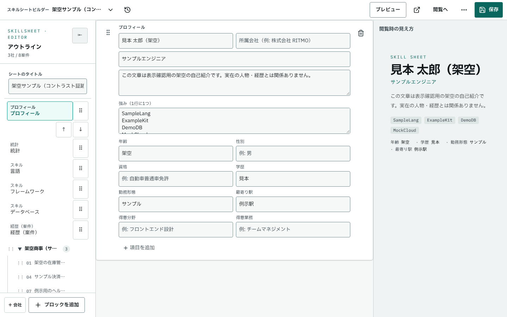 | 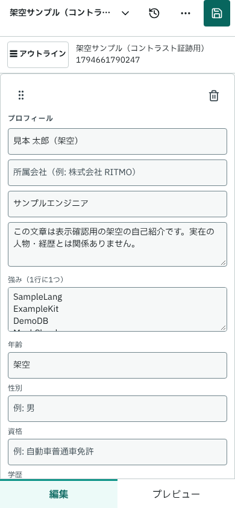 | 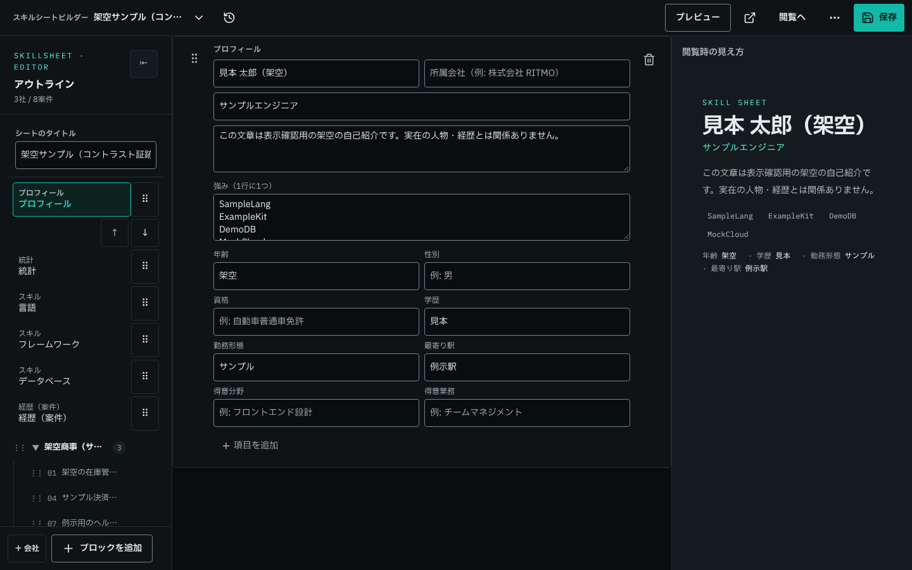 | 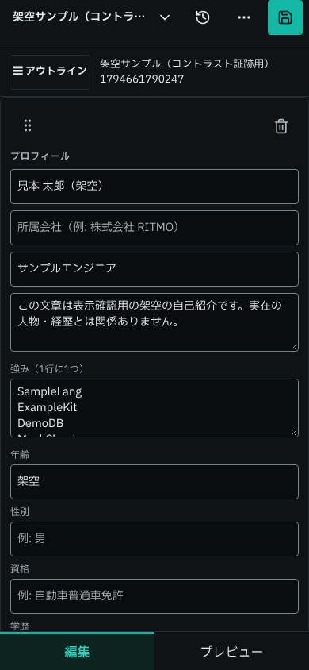 |
| 確認ダイアログ（danger） | 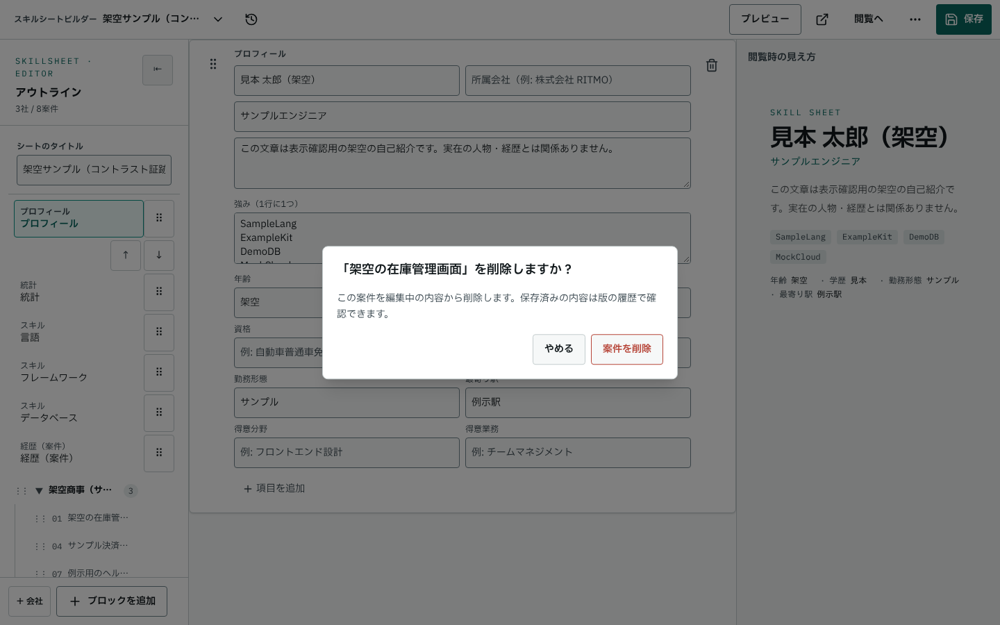 | 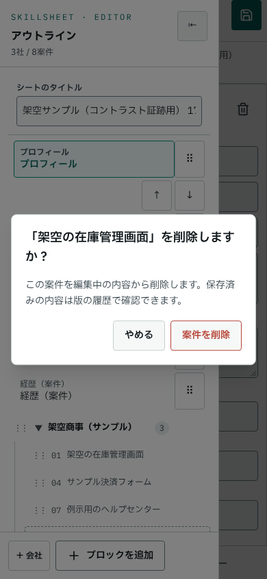 | 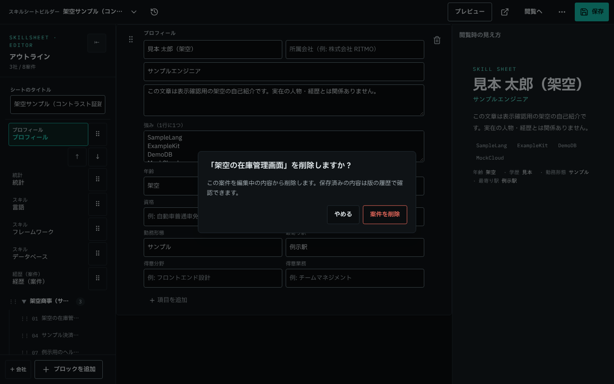 | 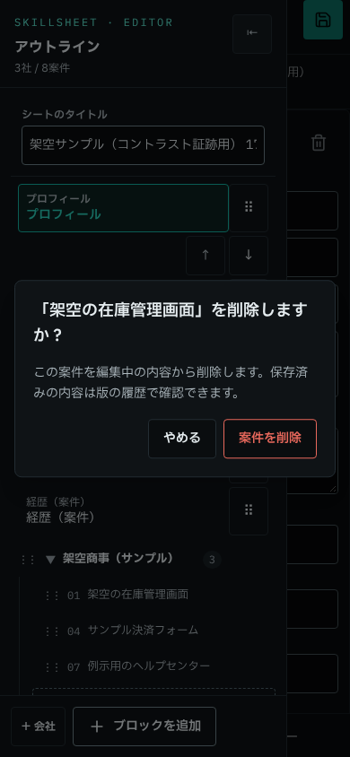 |
| 案件ナビ（削除ボタン） | 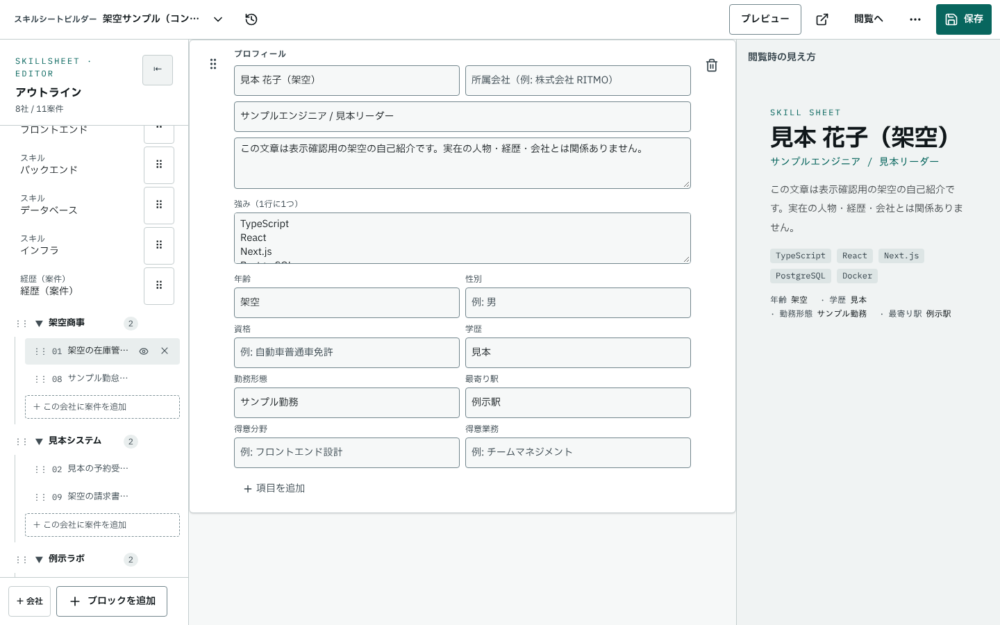 | 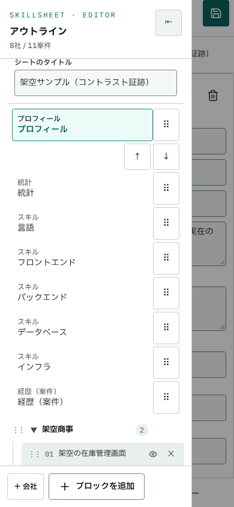 | 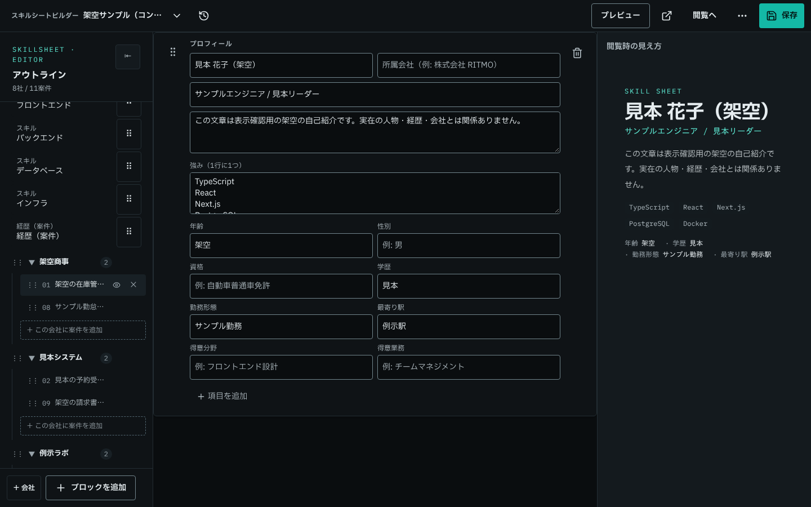 | 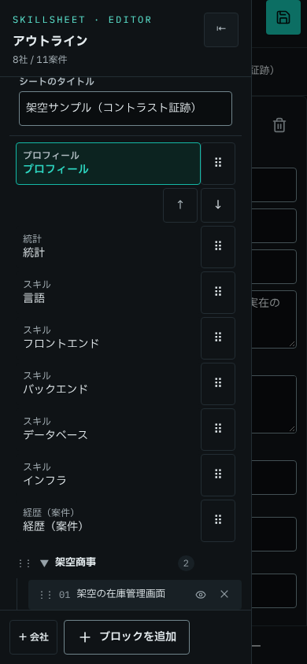 |
| 閲覧コードの画面（認証ボタン） | 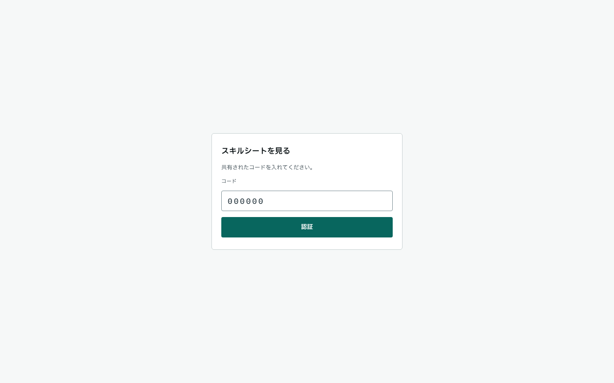 | 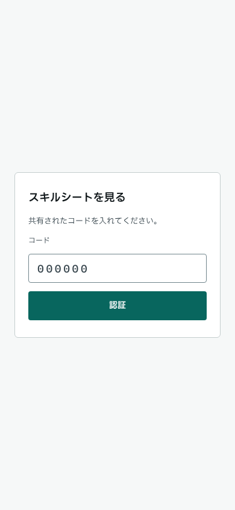 | 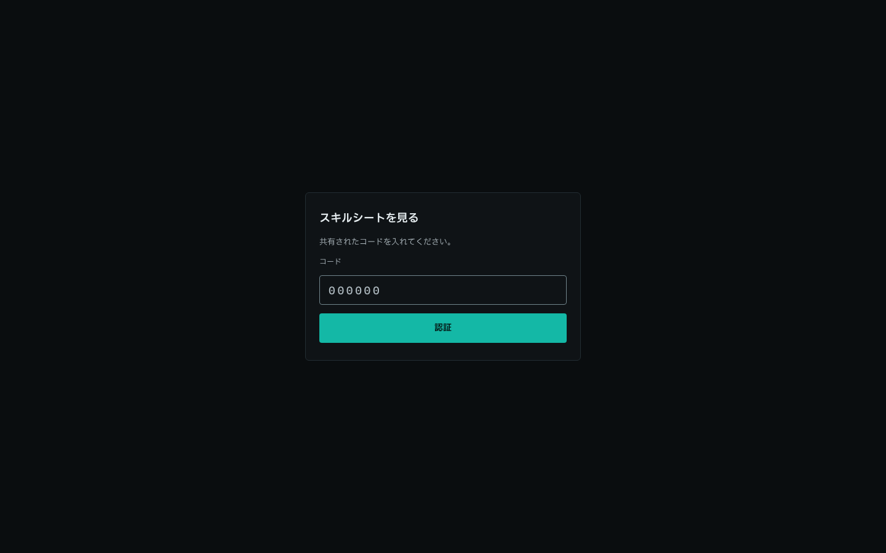 | 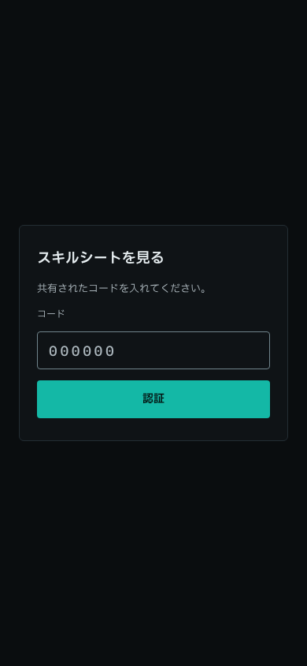 |

### 見て欲しいポイント

- [ ] 暗い配色の主ボタン・危険ボタンの色がボードに近いか
- [ ] 明るい配色の警告文字をボードの #6b4e00 に合わせた（AA は維持）
- [ ] hover の新色（明 #9f3a2f・暗 #f08a80）は私が選んだ。色相をボードの danger に揃え AA を保った値

### 見なくてもよいポイント

- [ ] `use-workspace-confirm.tsx` は触っていない（#668 の PR）。ダイアログの枠 60% などの形はそちら

### その他(あれば)

- 2026-11-14 は Vercel の無料プランの 1 日の配信回数を使い切っていて、この head の「Vercel」の状態が failure になることがある（Deployment rate limited — retry in 24 hours）。コードの失敗ではない。検査は持ち主の裁定どおり手元の検査（LOCAL-CHECK のコメント）で見る。

コメント: 色の値が変わって古くなった `app/globals.css`・`button.tsx`・`login/page.tsx` の説明を今の値に直した。

ローカル確認（head b2283fb。オーナー裁定で、手元でリポジトリの検査が通ることを CI 通過とみなす）:
- `pnpm lint` 0 / `pnpm type-check` 0 / `./script/check-naming.sh` 0 / `pnpm build` 通過
- `pnpm test`: jsdom 112 files・1120 tests 通過。node 77 files・1201 passed + 1 skipped + 1 failed。pdf 25 files・229 passed + 7 skipped。node の失敗 1 件は `script/verify-607-lifecycle.test.ts`（子プロセスの停止を 2 秒で待つ試験。ほかの作業で負荷が高い時に落ちた）で、このファイルだけを `--maxWorkers=1` で再実行すると 24 tests 通過。落ちたままの再実行ではない
- コントラストの e2e（隔離 DB・本番ビルド・Chromium・`e2e/contrast-render.spec.ts`・`input-contrast.spec.ts`・`text-contrast.spec.ts`・`text-contrast-synthetic.spec.ts`）: 35 passed（認証の setup 1 + 試験 34）・0 failed。`text-contrast-synthetic` は記録済みの結果と一致
- 試験は変更していない。main（4d8ca74）は取り込み済み。証跡用の撮影 spec は使い捨てでコミットしていない

---

### PR チェックポイント

- [x] タイトルに タスク管理ツール のチケット番号が入っているか
- [x] 複数の変更が 1 つの PR に入り込んでいないか
- [x] 開発環境修正はなし
- [x] AdminXXX or OwnerXXX の修正なし

🤖 Generated with [Claude Code](https://claude.ai/code)

https://claude.ai/code/session_01Cv4a6GH8YuxUe328FttVhH
