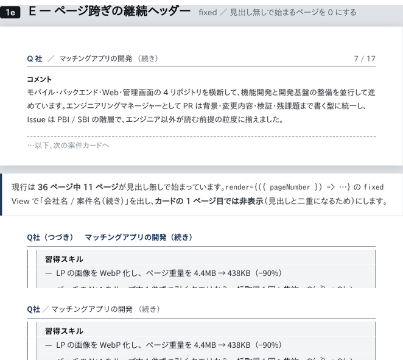
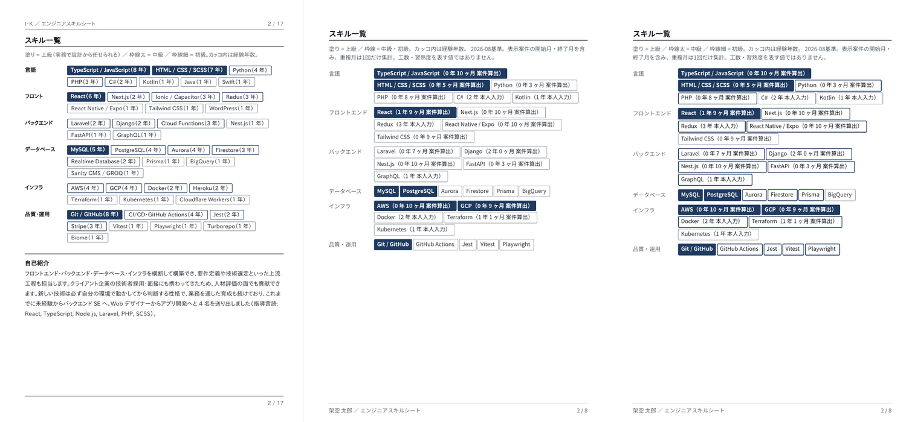

# PR 下書き（まだ作っていない）

- title: `[SBI][fix] PDF の続きの見出しと習熟度の段階をデザインどおりにする (#626)`
- base: `main`
- head: `fix/design-pdf-header-level`（16133b2）

## 本文

## Issue リンク / Link to Issue

SBI はリードが起票して Closes を足す。

### 概要

PDF デザイン板との突き合わせで見つかった差のうち、マネージャー裁定（JUDGE 4）の 4 件を `src/component/pdf/*` だけで直す。

| # | 項目 | 結果 |
|---|---|---|
| 1 | 継続見出し（1e） | 「Q 社 ／ 案件名 （続き）」に変更。会社名 accent/700、「／」と「（続き）」は label 色/400、案件名は text 色/400。位置は余白のまま動かさない。1 行内の「つづき」「続き」の混在をなくした（会社だけが続くページは「Q 社 （つづき）」。案件側の「（続き）」と字を分け、`continuesPreviousCard` が案件の続きだけを見分ける仕組みを保つため） |
| 2 | 習熟度（level モードのみ） | 上級=塗り / 中級=accent 太枠 1.25pt / 初級=灰細枠 0.75pt の 3 段。凡例も 3 段の語に。画面（`skill-matrix.tsx` が `skill.level` をそのまま表示）は 3 段を区別して出しているので PDF を合わせた。featured モードは変更なし |
| 3 | ウェイト 500 | トークンから `medium: 500` を外し、使っていた 3 箇所を 400 に。埋め込みは Regular と Bold の 2 本だけなので見た目は変わらない（`pdffonts` で 2 本のまま） |
| 4 | a8 対応可能工程が 5/7 | データ欠落ではなく意図どおり。変更なし（下の「その他」） |

画像（左から 板 | 変更前 | 変更後）:

画像は完全に合成したデータ（架空）から出した実 PDF をラスタライズしたもの。

### 見て欲しいポイント

- [ ] 会社だけが続くページの「Q 社 （つづき）」でよいか（板に例が無いため、現状の字を残した）
- [ ] 習熟度の 3 段で、上級・中級以外の値（空欄など）を初級と同じ細枠にしていること

### 見なくてもよいポイント

- [ ] `print-design-match.node.test.tsx` の pdfjs オペレーター読み取り（線幅は pdfjs が 2 倍で報告するため 1/2 にしている）

### その他(あれば)

- a8: 対応可能工程の集計は `print-view-model.ts` の `buildSummary`（約 577〜598 行）が `normalizeProcess`（`src/db/process.ts` 58〜72 行）の 7 段 `done` の和を取る。案件カードの「担当工程」も同じ関数を通す。完全一致の対応表（同 26〜38 行）に無い語は `other` に落とし、カードは `other` を文字で足す（`print-view-model.ts` の `formatProcessForPrint`）が、まとめは 7 段だけを出す。突き合わせ用の合成データが「結合」「総合」と書いていて、正準の「結合テスト」「総合テスト」ではなかったため、まとめだけ 5 になって見えた。正準の語なら 7 になる。表記ゆれ（`other` の語をまとめにどう出すか）は別の判断なので、この PR では触らない。
- 見た目の確認: `doc/design-pdf-evidence/`

🤖 Generated with [Claude Code](https://claude.ai/code)

https://claude.ai/code/session_01Cv4a6GH8YuxUe328FttVhH

LOCAL-CHECK: pnpm lint / type-check / test（jsdom・node・pdf の 3 本）/ build / pdf-layout-check 相当（合成 fixture、7 規則すべて 0）/ check-naming.sh すべて通過。新規テストは変更前の 4 件すべて失敗、変更後に通過。

---
_Generated by [Claude Code](https://claude.ai/code)_
